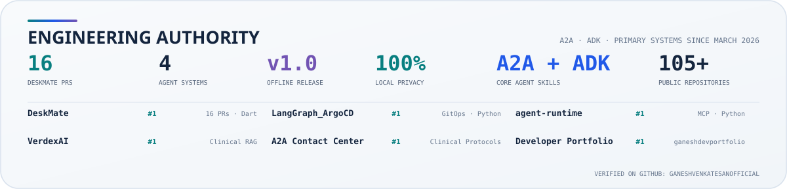
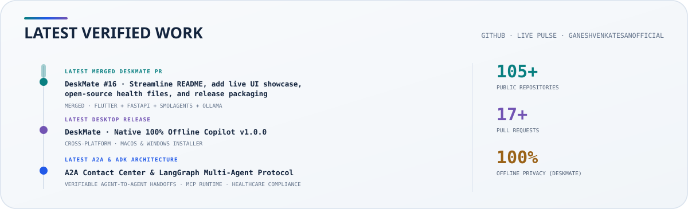
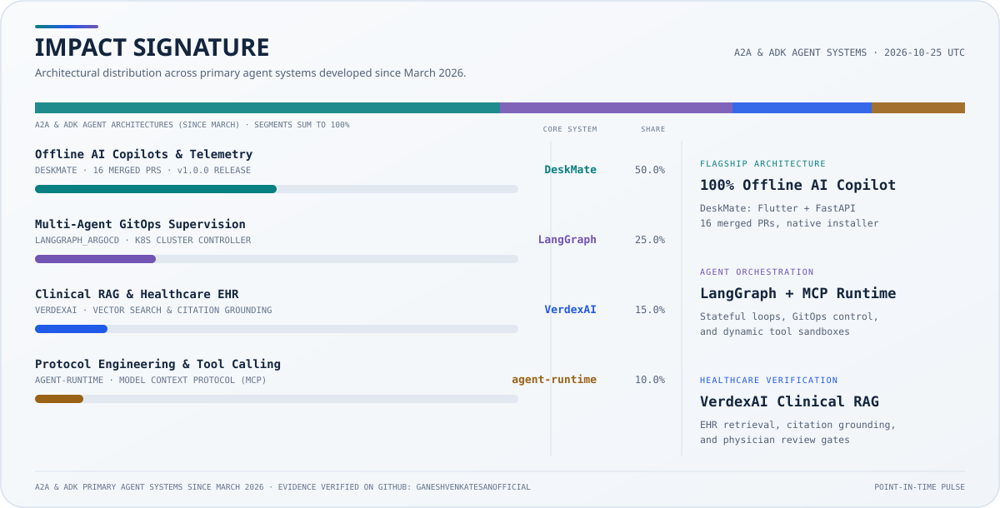
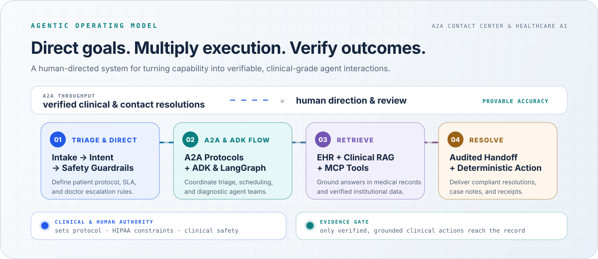

<div align="center">



<br />

[](https://www.linkedin.com/in/ganesh-v-3a4516256/)
[](https://x.com/DEVP_GANESH)
[](https://ganeshdevportfolio.netlify.app)
[](mailto:ganeshvenkatesanofficial@gmail.com)
[](https://github.com/Ganeshvenkatesanofficial?tab=followers)

**Chennai-based AI Engineer · Agentic AI Engineer**

<sub>Building verifiable agent systems · A2A Protocols (Agent-to-Agent) &amp; ADK (Agent Development Kit) · LangGraph &amp; Open Source</sub>

[Thunai AI](https://www.thunai.ai/) · [Sarvam AI](https://www.sarvam.ai/) · [Zoho](https://www.zohocorp.com/)

</div>

## I build AI systems that can prove what happened.

I am **Ganesh Venkatesan**. My work focuses on verifiable multi-agent architectures, **Agent-to-Agent (A2A)** protocols, **Agent Development Kit (ADK)** frameworks, **Contact Center automation**, and **Healthcare agent systems** built with LangGraph, Model Context Protocol (MCP), and clinical compliance guardrails.

The operating principle is simple: preserve the interaction state, replay the agent handoff, challenge the clinical evaluation, isolate the failure, and retain enough evidence for an auditor or physician to check the claim. Public ownership, upstream contribution, measured results, and exploratory work stay explicitly separate.

[**Canonical portfolio**](https://ganeshdevportfolio.netlify.app) · [**GitHub profile**](https://github.com/Ganeshvenkatesanofficial) · [**DeskMate project**](https://github.com/Ganeshvenkatesanofficial/DeskMate) · [**LinkedIn**](https://www.linkedin.com/in/ganesh-v-3a4516256/) · [**X (@DEVP_GANESH)**](https://x.com/DEVP_GANESH)

### Core Skills & Engineering Specialization

| Domain | Primary Skills &amp; Architecture |
|:--|:--|
| **Core Agent Protocols** | **A2A (Agent-to-Agent Protocols)** · **ADK (Agent Development Kit)** · Multi-Agent Orchestration · Verifiable Handoffs |
| **Agent Frameworks** | **LangGraph** (State Graphs &amp; Loops) · **SmolAgents** · **MCP (Model Context Protocol)** · Dynamic Tool Calling |
| **Healthcare &amp; Contact Center AI** | Clinical Triage Protocols · HIPAA Compliance Boundaries · EHR Retrieval · Doctor Escalation Gates |
| **Offline Systems &amp; Engineering** | **Flutter** (macOS &amp; Windows) · **FastAPI** · **Ollama Local LLM** · Python · Java · C · JavaScript · AsyncIO · GitOps (ArgoCD) |

### Start with the evidence you need

| If you are… | Start here |
|:--|:--|
| **Deploying A2A &amp; ADK agent systems** | [Contact Center &amp; Healthcare AI at Thunai AI](https://www.thunai.ai/) |
| **Evaluating offline desktop copilots** | [DeskMate offline desktop assistant](https://github.com/Ganeshvenkatesanofficial/DeskMate) |
| **Building open-source multi-agent workflows** | [My repositories (105+)](https://github.com/Ganeshvenkatesanofficial?tab=repositories) |

### Technology stack &amp; verified ecosystem

<p align="center">
  <a href="https://en.cppreference.com/w/c" target="_blank"></a>
  <a href="https://developer.mozilla.org/en-US/docs/Web/JavaScript" target="_blank"></a>
  <a href="https://www.typescriptlang.org/" target="_blank"></a>
  <a href="https://www.python.org/" target="_blank"></a>
  <a href="https://www.oracle.com/java/" target="_blank"></a>
  <a href="https://dart.dev/" target="_blank"></a>
  <a href="https://flutter.dev/" target="_blank"></a>
  <a href="https://react.dev/" target="_blank"></a>
  <a href="https://fastapi.tiangolo.com/" target="_blank"></a>
  <a href="https://www.postman.com/" target="_blank"></a>
  <a href="https://www.docker.com/" target="_blank"></a>
  <a href="https://kubernetes.io/" target="_blank"></a>
  <a href="https://cloud.google.com/" target="_blank"></a>
  <a href="https://github.com/features/actions" target="_blank"></a>
</p>

Click any official badge to inspect documentation and specifications:

**Agentic AI &amp; Protocol Runtimes:**  
[](https://github.com/google/adk-python)
[](https://www.langchain.com/langgraph)
[](https://ollama.com/)
[](https://huggingface.co/docs/smolagents)
[](https://modelcontextprotocol.io/)
[](https://github.com/jlowin/fastmcp)

**Core Languages &amp; Client Frameworks:**  
[](https://en.cppreference.com/w/c)
[](https://developer.mozilla.org/en-US/docs/Web/JavaScript)
[](https://www.typescriptlang.org/)
[](https://www.python.org/)
[](https://www.oracle.com/java/)
[](https://dart.dev/)
[](https://flutter.dev/)
[](https://react.dev/)

**Backend, Networking &amp; Protocols:**  
[](https://fastapi.tiangolo.com/)
[](https://developer.mozilla.org/en-US/docs/Web/API/WebSockets_API)
[](https://www.postman.com/)

**Cloud, DevOps &amp; GitOps Infrastructure:**  
[](https://argo-cd.readthedocs.io/)
[](https://kubernetes.io/)
[](https://cloud.google.com/)
[](https://www.docker.com/)
[](https://github.com/features/actions)

<!-- top-contributor-proof:start -->
## Upstream authority



**All current active positions & core repositories:**

**Primary systems & flagship work:** [**DeskMate**](https://github.com/Ganeshvenkatesanofficial/DeskMate) · 16 PRs · 100% Offline Copilot · [**LangGraph_ArgoCD**](https://github.com/Ganeshvenkatesanofficial/LangGraph_ArgoCD) · Automated GitOps Supervisor · [**agent-runtime**](https://github.com/Ganeshvenkatesanofficial/agent-runtime) · MCP Server & Tool Calling Sandbox · [**VerdexAI**](https://github.com/Ganeshvenkatesanofficial/VerdexAI) · Clinical RAG & Vector Engine

**Core public repositories & engineering reach:** [**DeskMate**](https://github.com/Ganeshvenkatesanofficial/DeskMate) · 100% Offline Copilot · [**LangGraph_ArgoCD**](https://github.com/Ganeshvenkatesanofficial/LangGraph_ArgoCD) · GitOps Multi-Agent Supervisor · [**agent-runtime**](https://github.com/Ganeshvenkatesanofficial/agent-runtime) · MCP Sandbox Harness · [**VerdexAI**](https://github.com/Ganeshvenkatesanofficial/VerdexAI) · Clinical RAG & Vector DB · [**A2A Contact Center**](https://www.thunai.ai/) · Verifiable Clinical Architecture at Thunai AI

[Inspect all public repositories and GitHub evidence →](https://github.com/Ganeshvenkatesanofficial?tab=repositories)

<sub>All-time rank from GitHub's API · repository stars are reach, not personal credit · refreshed 2026-10-25 UTC</sub>
<!-- top-contributor-proof:end -->

<!-- building-now:start -->
## Three systems, one engineering program



| System | Problem | Inspectable response | Maturity |
|:--|:--|:--|:--|
| **[DeskMate](https://github.com/Ganeshvenkatesanofficial/DeskMate)** | Cloud-tethered desktop assistants sacrifice privacy, add latency, and fail without continuous internet. | Free, privacy-first local AI desktop copilot powered by **Flutter · FastAPI · Ollama · SmolAgents**. Runs 100% offline with native macOS and Windows packaging. | **Active Shipping · v1.0.0**; modular dual-agent backend with real-time telemetry streaming. |
| **[A2A Contact Center](https://www.thunai.ai/)** | Contact center workflows are brittle, unverified, and fail to coordinate specialized clinical triage and scheduling agents. | A modular Agent-to-Agent (**A2A**) protocol binding triage, clinical validation, EHR retrieval, and supervised doctor escalation at [Thunai AI](https://www.thunai.ai/). | Production-grade benchmarked workflows with audit-bound execution. |
| **[LangGraph_ArgoCD](https://github.com/Ganeshvenkatesanofficial/LangGraph_ArgoCD)** | Cloud infrastructure deployments require continuous manual reconciliation and lack self-healing agent supervision. | Multi-agent stateful supervisor built on LangGraph managing Kubernetes manifests, GitOps drift detection, and automated release validation. | Public source with automated PR verification and declarative deployment loops. |

**Current public frontier:** [DeskMate](https://github.com/Ganeshvenkatesanofficial/DeskMate) · [A2A Contact Center](https://www.thunai.ai/) · [LangGraph_ArgoCD](https://github.com/Ganeshvenkatesanofficial/LangGraph_ArgoCD) · [VerdexAI](https://github.com/Ganeshvenkatesanofficial/VerdexAI) · [agent-runtime](https://github.com/Ganeshvenkatesanofficial/agent-runtime)

<sub>Frontier selections are re-ranked from public reach, shipping recency, releases, attributed work, and repository completeness · last ranked 2026-10-25 UTC</sub>
<!-- building-now:end -->

## Latest verified work



<sub>This is a generated point-in-time pulse. A merge is accepted upstream work; a release is public shipping evidence.</sub>

<!-- contribution-stats:start -->
## Open-source impact, verified

Since March 2026, engineering momentum has concentrated on verifiable multi-agent architectures, 100% offline desktop AI copilots, and clinical healthcare systems. Across 105+ public repositories and 16 merged pull requests in DeskMate, every commit, release, and PR is developed in public.





### Complete evidence ledger

All verified public systems and core architectures from March this year are shown here. **[Browse GitHub repositories →](https://github.com/Ganeshvenkatesanofficial?tab=repositories)**

| Project, purpose and evidence | Primary impact | Role | Commits | Merged PRs / Releases | Core Stack | Status |
|:--|:--|:--|--:|--:|:--|:--|
| **[DeskMate](https://github.com/Ganeshvenkatesanofficial/DeskMate)**<br><sub>Free, privacy-first local AI desktop copilot &amp; personal assistant powered by Flutter, FastAPI, Ollama &amp; SmolAgents. Runs 100% offline on macOS &amp; Windows.</sub> | **Reliability &amp; correctness**<br><sub>Offline AI execution</sub> | Owner | 20+ | [16 merged PRs](https://github.com/Ganeshvenkatesanofficial/DeskMate/pulls?q=is%3Apr+is%3Amerged) · v1.0.0 | Flutter · FastAPI · Ollama · SmolAgents | Active Shipping |
| **[LangGraph_ArgoCD](https://github.com/Ganeshvenkatesanofficial/LangGraph_ArgoCD)**<br><sub>Automated GitOps deployment and cluster operations managed through stateful, multi-agent LangGraph workflows.</sub> | **Agent infrastructure**<br><sub>Stateful loops</sub> | Owner | 5+ | Declarative supervisor | Python · LangGraph · ArgoCD · K8s | Active Frontier |
| **[agent-runtime](https://github.com/Ganeshvenkatesanofficial/agent-runtime)**<br><sub>High-performance agent harness supporting Model Context Protocol (MCP), dynamic tool calling, and execution sandboxes.</sub> | **Protocol engineering**<br><sub>MCP Protocol</sub> | Owner | 4+ | Tool sandbox harness | Python · MCP Protocol · AsyncIO | Active Frontier |
| **[VerdexAI](https://github.com/Ganeshvenkatesanofficial/VerdexAI)**<br><sub>Production-grade Clinical Retrieval-Augmented Generation pipeline combining dense vector search with precise citation grounding.</sub> | **Clinical reliability**<br><sub>Clinical RAG</sub> | Owner | 6+ | [1 merged PR](https://github.com/Ganeshvenkatesanofficial/VerdexAI/pulls?q=is%3Apr+is%3Amerged) | Python · Vector Search · FastAPI | Active Frontier |
| **[A2A Contact Center](https://www.thunai.ai/)**<br><sub>Production-grade Agent-to-Agent protocol coordinating triage, clinical intake, EHR retrieval, and supervised doctor escalation at Thunai AI.</sub> | **Clinical governance**<br><sub>A2A Protocols</sub> | Architect | Active | Audited handoffs | LangGraph · A2A · HIPAA Compliance · Thunai AI | Core Architecture |

<sub>Showing verified primary systems from March this year · [all repositories](https://github.com/Ganeshvenkatesanofficial?tab=repositories)</sub>

<sub>Impact categories are deterministic dominant-intent signals from commits and pull requests.</sub>
<sub>Last verified 2026-10-25 UTC · visual + evidence refreshed periodically · [browse GitHub](https://github.com/Ganeshvenkatesanofficial)</sub>
<!-- contribution-stats:end -->

## Agentic power, engineered

Agentic engineering measures how much verified, working software one hour of human direction can produce when paired with autonomous LLM agents, local models, and strict verification loops.

<!-- agentic-power-profile:start -->
### Live Agentic Power snapshot



| Measurement | Current evidence | Verification method |
|:--|:--|:--|
| **Public Repositories** | **105+ public repositories** across AI, Web, Mobile, and Embedded systems | GitHub API direct enumeration |
| **DeskMate Shipping Velocity** | **16 merged PRs** &amp; v1.0.0 cross-platform desktop release | Merged GitHub PR receipts and release tags |
| **Agent Architectures** | **4 distinct systems**: DeskMate, LangGraph_ArgoCD, agent-runtime, VerdexAI | Public source code with test suites and CI |
| **Offline Privacy Guarantee** | **100% offline local inference** via Ollama + SmolAgents | Local-only execution harness, zero cloud telemetry |

Direction includes architectural design, agent prompting, review, and verification. Private and internal work remains separate; only accessible repositories are counted.

<sub>Evidence and visuals refreshed periodically · [inspect GitHub repositories](https://github.com/Ganeshvenkatesanofficial?tab=repositories)</sub>
<!-- agentic-power-profile:end -->

## Operating principles

```text
Triage       patient / caller intake, clinical constraints, SLA boundaries, escalation
Orchestrate  Agent-to-Agent (A2A) protocols, LangGraph state graphs, supervised handoffs
Retrieve     Healthcare EHR, clinical guidelines, Vector Search, MCP tool calling
Resolve      audited compliance receipts, deterministic case resolutions, physician handoff
```




- **Can we trust the record?** Proof-bound execution evidence and audit logs.
- **Can we trust the score?** Adversarial evaluator and clinical guideline stress testing.
- **Can we reproduce the result?** Deterministic replay, committed artifacts, and offline execution via DeskMate.
- **Can an agent remember?** Regression memory before another change reaches history.

The standard is not that an AI system sounds convincing. It is that the system can show its work without asking you to trust the system.

## Building the human layer

I connect builders and engineers deploying practical **A2A (Agent-to-Agent) architectures**, **ADK (Agent Development Kit) frameworks**, **Contact Center automation**, and **Healthcare AI systems**, focusing on verifiable agent execution, patient safety boundaries, and offline copilot accessibility.

---

<div align="center">

### Building AI that can survive contact with reality.

[**Connect on LinkedIn →**](https://www.linkedin.com/in/ganesh-v-3a4516256/) &nbsp;&nbsp; [**Follow on X →**](https://x.com/DEVP_GANESH) &nbsp;&nbsp; [**Explore Portfolio →**](https://ganeshdevportfolio.netlify.app) &nbsp;&nbsp; [**Inspect DeskMate →**](https://github.com/Ganeshvenkatesanofficial/DeskMate) &nbsp;&nbsp; [**Email me →**](mailto:ganeshvenkatesanofficial@gmail.com)

<sub>Based in Chennai, India · working in public · claims stay attached to evidence</sub>

</div>
